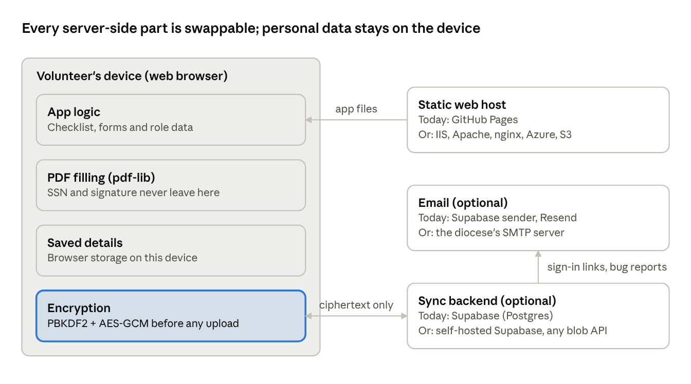

# Volunteer Clearances: Proposal for Diocesan Adoption

October 2026

## Summary

Volunteer Clearances is a free, open-source web app that walks volunteers through the Diocese of Allentown's Safe Environment requirements. It tracks each clearance and training, fills in the diocese's forms from one set of details, and keeps personal information on the volunteer's own device. A La Salle Academy (Shillington) parent built it as a volunteer project, and it is now a working prototype.

**The ask:** that diocesan IT review it and decide whether to endorse it, host it under a diocese address, or use it as the starting point for an official tool for every school and parish.

## The problem

The School Volunteer Requirements Checklist (revised 7/31/2025) has 12 items handled by state agencies, training providers, the diocese and the school. Most volunteers do it once every five years, so nobody remembers how.

- **Volunteers** download scanned PDFs, write the same name, address and birth date on six forms, and work out which items go to the school and which go to the state.
- **Handwritten forms can come back incomplete or hard to read**, and coordinators (LSECs) follow up one by one.
- **Renewals slip.** Clearances expire after five years, and nothing reminds the volunteer.
- **Sensitive data travels loosely.** SSNs and birth dates end up on paper, in email attachments and on shared family computers.

## What it does today

The prototype is live at [mcnearcj.github.io/lsa-vol-clearance-web](https://mcnearcj.github.io/lsa-vol-clearance-web/), and the source is public at [github.com/mcnearcj/lsa-vol-clearance-web](https://github.com/mcnearcj/lsa-vol-clearance-web). It is set up for La Salle Academy and labeled an early prototype.

| Feature | What the volunteer gets |
| --- | --- |
| Checklist | PATCH, Child Abuse History, FBI fingerprints, NSOR, Protecting God's Children, Mandated Reporter and the driver check, each with steps, links, a "done" date and a renewal date |
| Forms to sign | Six forms filled in from their details: Sexual Abuse, Code of Conduct, Social Media and CPSL acknowledgments, the Background Check Authorization and the state NSOR application (CY 1001) |
| Signing | Print and sign by hand (the default), or sign on screen by drawing or typing |
| SSN | Optional, entered only when making forms, placed only where a form needs it, never saved or sent |
| Submission checklist | A separate PDF to keep, listing what goes to the LSEC, what goes to the state, and what is still missing |
| Sync | Optional, end-to-end encrypted, across devices and browser tabs |
| Shared computers | Every page shows whose details are loaded, with a one-click "Not you?" reset |
| Help | The school LSEC and the diocesan contact, FAQs and a bug report form |

The forms come straight from the diocese's [Safe Environment Policies](https://www.allentowndiocese.org/safe-environment-policies) page. The site links to the official instruction sheets rather than rewriting them.

## How it's built, and how it adapts

The site is a static web app with no server code of its own. Every part sits behind a narrow interface, so the diocese can keep the current setup, move it onto its own infrastructure, or replace any single piece without rewriting the rest.

Everything personal happens inside the browser. The three services on the right only deliver files, store ciphertext or send email, so each can be replaced on its own.

| Component | Today | Can move to | What a change takes |
| --- | --- | --- | --- |
| Web app | React 19, TypeScript and Vite. The build is plain HTML, JavaScript and CSS files with relative paths | Any web server: IIS, Apache or nginx on premises, Azure Static Web Apps, AWS S3, or a subfolder of an existing diocese site | Copy the `dist/` folder. No runtime, database or server code is needed |
| Hosting | GitHub Pages, free | Any static host, under a diocese domain | Point DNS at it and update the sign-in redirect URL. [`DEPLOYING.md`](../DEPLOYING.md) has the steps |
| Form filling | pdf-lib, running in the browser | Stays in the browser, so no server change is needed | New form revisions: replace the PDF in `public/forms/`, then adjust field positions if the layout moved |
| Requirements and forms lists | Data files (`requirements.ts`, `forms.ts`, `site.ts`) | One configuration per school, parish or role checklist | Edit data, not code. A role picker could select among the diocese's checklists |
| Sync storage | Supabase (hosted Postgres) with one encrypted record per person | Self-hosted Supabase (open source), or any database behind a small API that stores one opaque blob per user | Data is encrypted before it leaves the device, so the backend only stores and returns ciphertext. Replacing it means rewriting one client module |
| Sign-in | Supabase email and password | The diocese's own identity provider (for example Microsoft Entra ID or Google Workspace) | Possible. The encryption key comes from the password today, so single sign-on would need a separate key step. See Risks |
| Email | Supabase's default sender for sign-in links; Resend for bug reports | The diocese's mail server over SMTP | Settings in Supabase, with no code change |
| Bug reports | A write-only database table plus an email | The diocese help desk's email or ticket system | Change one form target |
| Build and deploy | GitHub Actions: lint, 42 unit tests, build, deploy | Azure DevOps, GitLab or any CI that runs `npm` | Three commands: `npm ci`, `npm test`, `npm run build` |

Sync and bug reports are optional. With no backend configured, the checklist, forms and signing still work fully.

## Privacy and security model

Whoever runs the site cannot read volunteers' personal information, and that holds wherever the site is hosted. The model rests on four rules.

1. **Local first.** Details and progress are saved in the volunteer's own browser. PDFs are filled in on the device, and nothing is uploaded to make them.
2. **The SSN is never kept.** It is typed only when making forms, written only onto the forms that need it, and never saved, synced or sent. The finished files exist only in the tab's memory until downloaded, and a "Delete these files now" button clears them.
3. **Sync is end-to-end encrypted.** On the device, PBKDF2 (600,000 rounds) turns the password into two unrelated values: a sign-in secret for the server and an AES-GCM key for the data. The database holds ciphertext only, and row-level security limits each record to its owner.
4. **No third-party calls on page view.** Fonts and assets ship with the site, and there is no analytics or tracking.

| The operator can see | The operator cannot see |
| --- | --- |
| Email addresses of people who turn on sync | Names, addresses, birth dates, phone numbers |
| When each encrypted record was last updated | Clearance progress or dates |
| Bug reports people choose to send | SSNs or signatures, which never leave the device |

The trade-off: if a volunteer forgets their password, the synced copy can't be decrypted. They reset it and the site re-uploads from their device. A security review by diocesan IT is welcome; the code is public.

## Cost and operations

The site costs $0 a month today, and a diocese-wide setup would likely cost about $25 a month, or nothing on infrastructure the diocese already runs.

| Item | Today | At diocese scale |
| --- | --- | --- |
| Hosting | GitHub Pages, free | Free on GitHub Pages, or any existing diocese web server |
| Sync and bug reports | Supabase free tier | Supabase Pro, about $25 a month (no pausing, daily backups), or self-hosted on diocese servers |
| Sign-in and report email | Supabase sender and Resend free tier | The diocese's own SMTP server |
| Domain | None (github.io address) | A subdomain of an existing diocese domain |

Running it takes little work. Most effort goes to keeping forms and requirements current when the diocese revises them, which means a file swap and a check by eye. Dependency updates go through the automated lint, test and build pipeline. Free Supabase projects pause after a week of inactivity, so a scheduled job pings it every three days; a paid or self-hosted plan removes that need.

Supabase prices change, so the $25 figure is approximate.

## Adoption options

The diocese can adopt this in three phases, stopping after any one of them. Each phase builds on the last, and none forces a particular vendor.

### Phase 1: Endorse and host

- Move the site to a diocese address with diocesan branding and a support contact.
- Add the other role checklists (employees, clergy, parish volunteers, limited volunteers) as configuration, so one site serves every school and parish.
- Move sync to a diocese-controlled backend: paid Supabase, self-hosted Supabase, or a small API on existing servers.
- Send sign-in email from a diocese address.

### Phase 2: Official forms and e-signature policy

- Publish fillable, text-based versions of each form, including the Request for Driver Information Form, which isn't online today.
- Decide whether forms signed on screen are accepted. If yes, volunteers could hand in a finished PDF instead of paper.
- Add Spanish versions; the diocese already publishes some policies in Spanish.
- Run an accessibility review and a legal review of the wording.

### Phase 3: Online submission and coordinator dashboard

- Volunteers submit signed forms and certificates through the site instead of paper or email.
- LSECs get a dashboard showing each volunteer's status and upcoming renewals, with automatic reminders.
- Payment codes for background checks are shown only to signed-in volunteers of the right school, not published.
- Optional sign-in through the diocese's identity provider for staff.

## Decisions and resources needed

| Phase | Decision for the diocese | Resources |
| --- | --- | --- |
| 1 | Endorse it, and where it is hosted: as is, on a diocese domain, or on diocese servers | A subdomain, an SMTP account, a support contact, and the role checklists as current PDFs |
| 1 | Who owns the code: a fork under a diocese GitHub account, or contributions back to this repo | A staff member or volunteer to review changes |
| 2 | Whether on-screen signatures are accepted for diocesan forms (the state decides for the NSOR) | Safe Environment Office and legal review |
| 2 | Whether to publish fillable forms | The original source files for each form |
| 3 | Whether the diocese will hold submitted documents, and under what retention policy | A developer, a secure backend with document storage, and a privacy review |

## Risks, limitations and open questions

| Risk or limit | Mitigation |
| --- | --- |
| A form is filled in wrong, or a revised form isn't picked up | The site tells volunteers to check each form, links the official originals, and form updates are a file swap |
| It's maintained by one volunteer | The code is public, documented and tested, so diocesan IT or another developer can take it over |
| Single sign-on conflicts with password-based encryption | Keep a separate sync password, or use device-held keys; to be designed in Phase 3 |
| Online submission (Phase 3) would mean the diocese stores sensitive documents | A deliberate change to the privacy model, needing its own security and retention review |
| Free-tier services pause or change terms | Paid or self-hosted backends; the core site needs no backend at all |

Open questions:

- [ ] Are forms signed on screen accepted by the diocese, and by the state for the NSOR?
- [ ] Can the Request for Driver Information Form be published?
- [ ] Should Limited Volunteers get their own checklist on the site?
- [ ] What does the "UEID" field on the checklist refer to?

## Next steps

1. Try the [live site](https://mcnearcj.github.io/lsa-vol-clearance-web/) as a volunteer would, and skim the [source code](https://github.com/mcnearcj/lsa-vol-clearance-web).
2. Hold a 30-minute call with diocesan IT and the Safe Environment Office to walk through it and answer questions.
3. Pick a phase and a hosting option from the table above.
4. If the answer is yes, hand over the code and deployment notes, then help with the move.

To reach the developer, send a message through **Report a problem** on the site's [Help page](https://mcnearcj.github.io/lsa-vol-clearance-web/) (no account needed), or [open an issue](https://github.com/mcnearcj/lsa-vol-clearance-web/issues/new) on the GitHub repository (needs a free GitHub account; issues are public).
